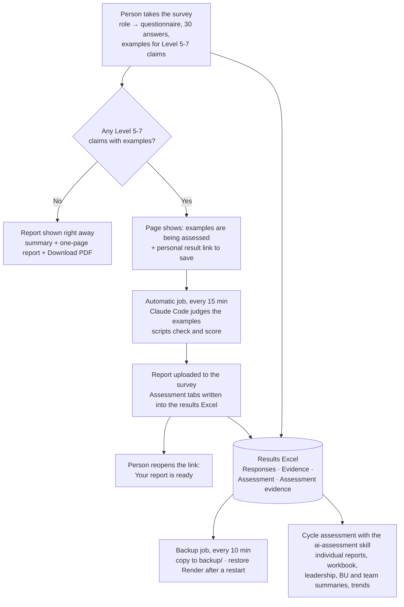

# AI adoption check-in

A web survey that places technology team members on a 7-level AI adoption scale for their role, proves the advanced levels with real examples, and gives every person a one-page report with what to do next. Leadership gets the same results rolled up by role, team and BU, with trends from one cycle to the next.

- Participants: `/` (no sign-in)
- Admins and reviewers: `/admin`
- Live trial: <https://tech-adoption.onrender.com> (Render, trial mode)

## The strategy in short

1. **One scale for everyone, questions per role.** Levels 0–7 (Not started → Transformer). Each of the 24 team roles maps to one of 6 questionnaires (Developer, QA/SDET, Tech Lead, Architect, Data, PM/Analyst/Service/Central Function), 30 questions each.
2. **Simple, published rules.** A practice counts at **C or higher** for Levels 1–2 and **D or higher** for Levels 3–7. A level is reached when **at least half** of its practices count, with no skipping. Score = level + share of the next level already in place (for example 4.2).
3. **Levels 5–7 need proof.** Each claim needs a real example, judged against a 4-point checklist:

   | Level | The example must show |
   | --- | --- |
   | 5 Advanced | real task · AI did the steps · output checked · done regularly |
   | 6 Multiplier | shared thing · who uses it · where it lives · what changed for them |
   | 7 Transformer | before and after · who adopted it · measured result · owner or guardrails |

   4 of 4 = Meets · 3 of 4 = Needs more evidence · 2 or fewer = Does not meet. Only "Meets" counts toward the confirmed level.
4. **Claude judges examples; scripts decide levels.** Claude only marks the 4 checks, with exact quotes from the example. The scripts apply the rules, so the same answers always give the same level. Blind tests on the sample data agree 100% with the reference judgements.
5. **Results go to the person on the survey page, not by email.** Nothing is emailed to participants.
6. **Every cycle is comparable.** Rules are versioned (`assessment/rules.json`); each cycle is saved and compared with the previous one.

The full rules are in [assessment/RUBRIC.md](assessment/RUBRIC.md).

## End-to-end workflow



### 1. Taking the survey

The person enters name, employee ID, email and team role; the survey picks the questionnaire for that role. Each question has answers A–E. Answers of D or E at Levels 5–7 ask for an example (what was done, how it was checked, how often); a follow-up question may be asked when the example is thin. Every submission is written to the results Excel file (`Responses` and `Evidence` sheets).

### One check-in per person per cycle, with surveyor approval

A second check-in from the same Employee ID in the same cycle is blocked with a message naming the surveyor (`SURVEY_OWNER`). The person's answers stay on the page. On `/admin` the surveyor opens the earlier check-in and chooses:

- **Approve a new check-in**: status `Reopened`, `New check-in approved` = Yes. The person clicks Submit again and the new check-in counts.
- **Mark as test entry**: status `Test`, for trial runs before the real survey. The person can then send their real check-in.
- **Mark as deleted**: status `Deleted`.

Every change is recorded in the results Excel itself (Responses sheet: `Status`, `New check-in approved`, `Status changed by`, `Status changed on (UTC)`). Only `Submitted` check-ins are assessed; the scripts and the skill skip `Reopened`, `Test`, `Deleted` and `Superseded` rows (`excludeStatuses` in `assessment/rules.json`).

### 2. The result page

- **No examples to judge:** the report appears as soon as the survey is submitted: a summary (level, score, what is needed for the next level), the one-page report, and **Download PDF**.
- **Examples to judge:** the page says the examples are being assessed and shows a **personal result link** to save. The page checks again every 2 minutes; once judged it shows **Your report is ready**.
- The link works any number of times. Each time, the report is rebuilt from the results Excel, so it survives browser clears and server restarts.
- Admins can copy any person's link from `/admin` (**Copy result link**).

### 3. Judging examples (automatic job)

`assessment/auto/run-auto.js` runs on a timer on the surveyor's machine:

1. Reads the latest results from the backup folder and picks new or changed submissions.
2. `prepare.js` applies the quality filter (at least 12 real words) and writes the examples to judge, without names.
3. Claude Code (headless) judges each example against [RUBRIC.md](assessment/RUBRIC.md) Part B.
4. `report.js --check` validates every judgement (quotes must appear in the text), then builds the report.
5. Uploads the report and writes that person's rows into the `Assessment` and `Assessment evidence` tabs of the live results Excel.

Config: [assessment/auto/config.json](assessment/auto/config.json). `onlyEmails` limits the job to listed people for testing; empty it for a real run. The job needs the same `RESULTS_TOKEN` as the survey (in `assessment/auto/results-token.txt`, not in git).

### 4. Backup and restore

`scripts/backup-from-render.sh` runs every 10 minutes:

- Downloads the results Excel and keeps a timestamped copy in `backup/` when it changed (`render-results-latest.xlsx` is always the newest).
- If submissions disappeared (Render's Free plan wipes the file on every restart or deploy), it sends the previous copy back; the survey merges it with anything submitted since.
- Rebuilds `backup/AI Survey Review.xlsx`.

Before pushing to GitHub (which redeploys), run the backup once by hand.

### 5. The cycle assessment (all employees)

Run in Claude Code on the surveyor's machine with the **`/ai-assessment`** skill ([.claude/skills/ai-assessment/SKILL.md](.claude/skills/ai-assessment/SKILL.md)):

```bash
node assessment/prepare.js --in "<results.xlsx>"
# Claude judges the batches (step 3 of the skill)
node assessment/report.js --in "<results.xlsx>" --check
node assessment/report.js --in "<results.xlsx>" --org "<org file>" --in-place
```

It produces, in `assessment/out/`:

- one-page individual reports (HTML and PDF),
- `AI Assessment Report.xlsx`: Summary, Individuals, Next steps, Evidence, Practices, Groups, Gap map, Trends, Flags, Method,
- leadership, BU and team summaries,
- the results Excel with the **Assessment** and **Assessment evidence** tabs added (`--in-place` writes them into the file itself; the result links read these tabs).

Group levels (team, role, BU, organisation) use the median person and are shown only with at least 5 people and 60% coverage. The org file (Employee ID → BU, project team, manager, tech lead) adds those groups and the coverage figures. Each cycle is saved in `assessment/history/` for trends.

## Project layout

| Path | What it holds |
| --- | --- |
| `src/` | Survey server (Express): submit, result link, admin, Excel storage |
| `public/` | Survey and admin pages |
| `data/questions.json` | Questionnaires, team role → questionnaire map |
| `assessment/` | Rule engine (`rules.json`, `RUBRIC.md`, `lib.js`), `prepare.js`, `report.js`, report templates, history |
| `assessment/auto/` | Automatic per-submission job |
| `assessment/sample/` | Sample data generator, expected results, reference judgements, `compare.js` |
| `.claude/skills/ai-assessment/` | The assessment skill and standard report templates |
| `scripts/` | Backup and restore, review report, workbook setup, `systemd/` timers |
| `backup/` | Results copies and sample data (not in git: personal data) |

## Running it

**Locally (trial mode, no Microsoft 365 or Claude needed):**

```bash
npm install
DEV_MOCK=true NODE_ENV=development EXCEL_LOCAL_PATH="./backup/local.xlsx" npm start
```

Open <http://localhost:3000>; sign in to `/admin` with `/auth/signin?as=admin`.

**On Render (current trial):** service `tech-adoption`, auto-deploys from `main` on GitHub. Start command:

```
DEV_MOCK=true NODE_ENV=development EXCEL_LOCAL_PATH="/tmp/AI Survey Results 2026.xlsx" ENABLE_RESULTS_EMAIL=false REQUIRE_EMAIL_CODE=false npm start
```

Environment: `NODE_VERSION=22`, `BASE_URL`, `SESSION_SECRET`, `RESULTS_TOKEN`, `CYCLE_NAME`, `ALLOWED_EMAIL_DOMAINS`, `ALLOW_RESUBMIT`, plus the values in `.env.example`.

**Timers on the surveyor's machine** (systemd user units in `scripts/systemd/`):

```bash
systemctl --user enable --now ai-survey-backup.timer   # backup and restore (on)
systemctl --user enable --now ai-survey-auto.timer     # automatic judging (off until the rollout starts)
```

**Testing with sample data** (25 made-up people named by role, all 24 team roles):

```bash
node assessment/sample/make-sample.js            # backup/sample_data.xlsx
node assessment/prepare.js --in backup/sample_data.xlsx --out assessment/out-test
# judge the batches, then:
node assessment/report.js --in backup/sample_data.xlsx --org backup/sample_org.csv --out assessment/out-test --history-dir assessment/out-test/history
node assessment/sample/compare.js --out assessment/out-test --in backup/sample_data.xlsx
```

Sample data must never be loaded into the live survey.

## Production setup

Trial mode keeps results in a temporary file on Render. For the real rollout (Microsoft Entra sign-in, results in a shared Excel file in OneDrive or SharePoint, Azure App Service), follow [SETUP.md](SETUP.md).

## Privacy

Results, backups and assessment outputs hold personal data. `backup/`, `assessment/out*/`, `assessment/history/` and all tokens are kept out of git. Reports go only to the person they are about, through their personal link.
