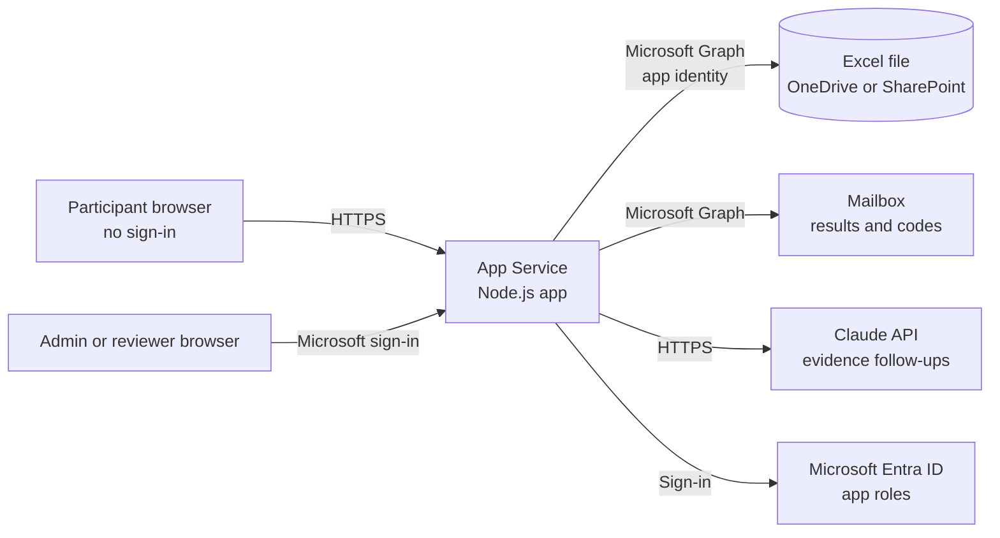

# AI adoption check-in: setup guide

This guide takes the app from a zip file to a running survey on Azure App Service. Each submission is written into a shared Excel file in OneDrive or SharePoint. Plan on half a day, most of it waiting on Microsoft 365 admin approvals.

## 1. What you are deploying



| Who | How they get in | What they can do |
| --- | --- | --- |
| Participant | Opens the link; no account needed. Enters their Employee ID (or work email when on probation); name, email and role are filled in from the employee list. Optionally confirms the email with a 6-digit code. | Takes the check-in, sees the final score, emails the results to themselves |
| Reviewer | Signs in with Microsoft; needs the **Survey.Reviewer** app role | Sees all responses, the spreadsheet view, and the review queue; records decisions on evidence; downloads the Excel file |
| Admin | Signs in with Microsoft; needs the **Survey.Admin** app role | Everything a reviewer can do, plus marking responses as inactive, test entries or approving a new check-in |

**Where data lives.** The Excel workbook is the only store. It has a **Responses** sheet (one row per submission, with the same first 35 columns as the baseline workbook's Response Log) and an **Evidence** sheet (one row per example, including reviewer decisions). Participants' unfinished answers stay in their own browser until they submit.

**Project layout**

| Path | Purpose |
| --- | --- |
| `src/server.js` | Web server and all API routes |
| `src/auth.js` | Microsoft sign-in for admins and reviewers (OpenID Connect with PKCE) |
| `src/graph.js` | Microsoft Graph calls (Excel and mail) with retry on throttling |
| `src/store.js` | Reads and writes the Excel tables; in-memory store for local trials |
| `src/claude.js` | Evidence follow-up and rating through the Claude API |
| `src/scoring.js` | Scoring rules, shared by server and browser |
| `src/config.js` | Reads all settings from environment variables |
| `data/questions.json` | The 6 questionnaires, 10 cross-role questions, answer scales, and the 24 team-role mappings |
| `public/` | Participant page (`index.html`, `app.js`) and admin page (`admin.html`, `admin.js`) |
| `scripts/` | `resolve-file.js` and `setup-workbook.js` for first-time setup |

## 2. Before you start

You need:

- **Azure:** a subscription and a resource group where you can create an App Service.
- **Microsoft Entra ID:** someone who can create an app registration and grant admin consent (Cloud Application Administrator or Global Administrator).
- **Exchange Online:** a mailbox to send from (a shared mailbox such as `ai-adoption-survey@yourdomain`), and an Exchange admin to limit the app to that mailbox.
- **OneDrive or SharePoint:** the place where the Excel file will live. A SharePoint site owned by the survey team is better than a personal OneDrive, because it survives people leaving.
- **Claude API:** an API key from the Anthropic Console (console.anthropic.com), ideally in a workspace with a spend limit.
- **Information Security sign-off:** the app sends evidence text to the Claude API and stores names, employee IDs, and emails in Excel. Get approval before launch.
- **Node.js 22** on your machine for local trials and the setup scripts.

## 3. Try it locally first (no Microsoft 365 or Claude needed)

```bash
cd ai-adoption-survey
npm install
cp .env.example .env
# In .env set: DEV_MOCK=true, NODE_ENV=development, BASE_URL=http://localhost:3000
npm run dev
```

Then:

- Open `http://localhost:3000` and complete a check-in. With `REQUIRE_EMAIL_CODE=true`, the code is printed in the terminal instead of emailed.
- Open `http://localhost:3000/auth/signin?as=admin` (or `?as=reviewer`) to see the admin page.

In this mode, data is kept in memory and lost when you stop the app, and evidence follow-ups use a simple stand-in instead of Claude, unless you also set `ANTHROPIC_API_KEY`. Mock mode refuses to start with `NODE_ENV=production`.

## 4. Step 1: Create the Excel file

1. In the SharePoint site's document library (or a OneDrive folder), create a new, empty Excel workbook, for example `AI_Adoption_Responses.xlsx`.
2. Share the file (or its folder) with the admins and reviewers so they can open it in Excel online. Participants do not need access.
3. Copy a sharing link to the file. You will use it in Step 6.

Do not add columns or rename sheets in this file later. The setup script creates the sheets and tables the app expects. You can add your own extra sheets (charts, pivot tables) next to them.

## 5. Step 2: Register the app in Microsoft Entra ID

In the Entra admin center, go to **App registrations** and choose **New registration**.

1. **Name:** `AI Adoption Survey`. **Supported account types:** this organizational directory only.
2. **Redirect URI:** platform **Web**, value `https://<your-app-name>.azurewebsites.net/auth/redirect`. For local testing against the real tenant, also add `http://localhost:3000/auth/redirect`.
3. After it is created, note the **Application (client) ID** and **Directory (tenant) ID**.
4. **Certificates & secrets:** create a client secret and copy its value right away. Put a reminder in your calendar before it expires.
5. **API permissions:** add Microsoft Graph **Application** permissions, then choose **Grant admin consent**:
   - `Files.ReadWrite.All`, or the narrower `Sites.Selected` (see Step 3).
   - `Mail.Send`, then restrict it to one mailbox (see Step 3).

   The delegated `openid`, `profile`, and `email` scopes used for admin sign-in need no extra consent in most tenants.
6. **App roles:** create two roles, each with allowed member types **Users/Groups**:

   | Display name | Value | Description |
   | --- | --- | --- |
   | Survey Admin | `Survey.Admin` | Full access to responses, reviews, downloads, and delete or restore |
   | Survey Reviewer | `Survey.Reviewer` | View responses, review evidence, and download the Excel file |

7. Go to **Enterprise applications**, open **AI Adoption Survey**, then **Users and groups**. Assign each admin and reviewer, or a security group, to the right role.
8. In the same enterprise app's **Properties**, set **Assignment required** to **Yes**, so nobody else can sign in to the admin page.

## 6. Step 3: Limit what the app can reach

Application permissions are powerful, so narrow them before go-live.

**Files.** `Files.ReadWrite.All` lets the app reach every file in the tenant. If the workbook is in a SharePoint site, use `Sites.Selected` instead, and have a SharePoint or Global admin grant the app **write** access to that one site through the Graph site permissions endpoint (`POST /sites/{site-id}/permissions`). With `Sites.Selected`, `npm run resolve-file` may not work from a sharing link. In that case, get the IDs from Graph Explorer with `GET /sites/{site-id}/drive/root:/{path-to-file}`, where `id` is the item ID and `parentReference.driveId` is the drive ID.

**Mail.** Without a restriction, `Mail.Send` lets the app send as any mailbox. Ask your Exchange admin to limit the app to the survey mailbox only. Exchange Online offers two ways to do this, RBAC for Applications or an application access policy. Microsoft is steering customers toward RBAC for Applications, so follow your Exchange team's current standard.

## 7. Step 4: Get a Claude API key

Create a key in the Anthropic Console and store it in Azure Key Vault (Step 7). The app sends only the question, the answer chosen, and the participant's example text, never names, IDs, or emails. If the key is missing or the API is unreachable, participants still finish: they get a fixed follow-up question, and their examples are marked **Not assessed** for human review.

The model is set by `ANTHROPIC_MODEL` (default `claude-sonnet-5-5`). Check the Anthropic model documentation for current model names before launch.

## 8. Step 5: Configure settings

Set these as App Service **application settings**, or in `.env` for local runs. Put the three secrets in Key Vault and reference them (Step 7).

| Setting | Required | Example or default | Meaning |
| --- | --- | --- | --- |
| `BASE_URL` | Yes | `https://ai-adoption-survey.azurewebsites.net` | Public address of the app; must match the redirect URI |
| `SESSION_SECRET` | Yes, secret | 64 random characters | Signs sessions, receipts, and review ratings |
| `NODE_ENV` | Yes | `production` | Turns on secure cookies |
| `ENTRA_TENANT_ID` | Yes | GUID | Directory (tenant) ID |
| `ENTRA_CLIENT_ID` | Yes | GUID | Application (client) ID |
| `ENTRA_CLIENT_SECRET` | Yes, secret | | Client secret value |
| `ADMIN_APP_ROLE` | No | `Survey.Admin` | App role value for admins |
| `REVIEWER_APP_ROLE` | No | `Survey.Reviewer` | App role value for reviewers |
| `EXCEL_DRIVE_ID` | Yes | | From Step 6 |
| `EXCEL_ITEM_ID` | Yes | | From Step 6 |
| `MAIL_SENDER` | Yes | `ai-adoption-survey@yourdomain` | Mailbox the app sends from |
| `ENABLE_RESULTS_EMAIL` | No | `true` | Shows the "Email my results" button |
| `ANTHROPIC_API_KEY` | Recommended, secret | | Claude API key |
| `ANTHROPIC_MODEL` | No | `claude-sonnet-5-5` | Model used for evidence follow-ups |
| `CYCLE_NAME` | No | `Baseline 2026` | Written on every row; change it each quarter |
| `ALLOW_RESUBMIT` | No | `false` | If `true`, a new submission marks the earlier one in the same cycle as Superseded |
| `ALLOWED_EMAIL_DOMAINS` | Recommended | `yourdomain.org` | Comma-separated; other domains are refused |
| `REQUIRE_EMAIL_CODE` | Recommended | `true` | Participants confirm their email with a 6-digit code before starting |
| `LEVEL_THRESHOLD` | No | `0.6` | Share of a level's questions that must be met |
| `MET_SCORE` | No | `3` | Answer score that counts as met (D = 3, E = 4) |
| `DEV_MOCK` | No | `false` | Local trial mode; never in production |
| `ADMIN_PASSCODE` (or `PASSCODE`) | With `DEV_MOCK` | | The surveyor's passcode for `/admin` in trial mode. Without it trial sign-in works only on localhost |
| `PEOPLE_PATH` | No | temp folder | Where the employee list sent by the backup job is kept |

Generate a session secret with: `node -e "console.log(require('crypto').randomBytes(48).toString('base64url'))"`

## 9. Step 6: Point the app at the workbook

Run these from your machine, with `.env` filled in and `DEV_MOCK=false`:

```bash
npm run resolve-file -- "<sharing link to the Excel file>"
# copy the EXCEL_DRIVE_ID and EXCEL_ITEM_ID values it prints into .env and App Service

npm run setup-workbook
# creates sheets Responses and Evidence with tables tblResponses and tblEvidence
```

Open the file in Excel online afterward. You should see the two sheets with header rows. Running the script again is safe, because existing tables are left alone.

## 10. Step 7: Deploy to Azure App Service

The commands below use the Azure CLI. Run `az webapp list-runtimes --os linux` first to confirm the exact Node 22 runtime name in your region.

```bash
RG=rg-ai-adoption
APP=ai-adoption-survey          # must be globally unique
az group create -n $RG -l centralindia
az appservice plan create -n asp-ai-adoption -g $RG --is-linux --sku B1
az webapp create -n $APP -g $RG -p asp-ai-adoption --runtime "NODE:22-lts"

az webapp update -n $APP -g $RG --https-only true
az webapp config set -n $APP -g $RG --always-on true --startup-file "npm start"
az webapp config appsettings set -n $APP -g $RG --settings \
  SCM_DO_BUILD_DURING_DEPLOYMENT=true NODE_ENV=production \
  BASE_URL=https://$APP.azurewebsites.net CYCLE_NAME="Baseline 2026" \
  ENTRA_TENANT_ID=... ENTRA_CLIENT_ID=... EXCEL_DRIVE_ID=... EXCEL_ITEM_ID=... \
  MAIL_SENDER=... ALLOWED_EMAIL_DOMAINS=... REQUIRE_EMAIL_CODE=true

# from the project folder (without node_modules and .env):
zip -r ../app.zip . -x "node_modules/*" ".env"
az webapp deploy -n $APP -g $RG --src-path ../app.zip --type zip
```

Then:

1. **Secrets in Key Vault.** Create a Key Vault, add `SESSION_SECRET`, `ENTRA_CLIENT_SECRET`, and `ANTHROPIC_API_KEY`, turn on the web app's system-assigned managed identity, give it read access to the vault's secrets, and set each app setting to a reference such as `@Microsoft.KeyVault(SecretUri=https://<vault>.vault.azure.net/secrets/SESSION-SECRET/)`.
2. **One instance only.** Keep the plan at 1 instance and do not turn on autoscale. Sessions, email codes, and the write queue that keeps Excel rows from colliding are all held in memory.
3. **Health check.** In the portal, under **Monitoring > Health check**, set the path to `/healthz`.
4. **Network access (optional).** To keep the survey on the corporate network, add access restrictions for your office and VPN IP ranges.
5. Make sure the redirect URI in the app registration matches `BASE_URL` exactly. If you add a custom domain, update both.

## 11. Step 8: Test before launch

- [ ] Open the app as a participant from a phone and a laptop, and complete one check-in with at least one Level 5 example.
- [ ] Confirm a new row appears in **Responses** and a row per example in **Evidence**, and that employee IDs with leading zeros are kept.
- [ ] Submit again with the same employee ID and check that it is refused, or marked Superseded if `ALLOW_RESUBMIT=true`.
- [ ] Use **Email my results** and check the email arrives from the survey mailbox.
- [ ] Try an email from another domain and check it is refused.
- [ ] Sign in at `/admin` as a reviewer, record a decision, and check the Evidence row and the Responses counts update.
- [ ] Check that a reviewer has no **Mark as inactive** button and that an admin does.
- [ ] Sign in with an account that has no role and check you see **No access**.
- [ ] Click **Download Excel file** and **Open in Excel online**.

## 12. Running the survey

- **Participants:** send the app address. They need no account. Ask them to finish in one sitting on one browser, since unfinished answers are saved only in that browser.
- **Admins and reviewers:** go to `<app address>/admin` and sign in with Microsoft. Use the **Review queue** tab to work through examples. Decisions are written straight into the Evidence sheet.
- **Excel:** the workbook updates as people submit. Admins can open it in Excel online or download it from the admin page. Avoid editing the two tables by hand while the survey is open, since that can collide with the app's writes. Read-only formulas, pivots, and charts on other sheets are fine.
- **New quarter:** change `CYCLE_NAME` (for example `Q1 2027`) and restart the app. New rows carry the new cycle, and the duplicate check applies per cycle.
- **Copy into the baseline workbook:** the first 35 columns of **Responses** match the Response Log in `AI_Adoption_Baseline_Self_Assessment.xlsx`, so they can be pasted across directly.

## 13. Security and privacy notes

- Participants are not signed in. Restricting email domains and requiring the email code make impersonation much harder. Even without the code, results emails go only to the address stored with the submission.
- AI ratings are signed by the server, so a participant cannot alter them before submitting. Scores are recalculated on the server from the answers.
- Text that Excel would treat as a formula is stored as plain text.
- The API limits requests per IP address. Evidence text is capped at 2,000 characters.
- Admin pages need a Microsoft sign-in with one of the two app roles. Changes require a same-site request with a custom header.
- Decide with Information Security how long to keep the workbook, and who can open it.

## 14. Limits and when to change the design

- Excel is a good store for a few hundred submissions per cycle. For much larger volumes, or several app instances, move storage to Azure SQL or Dataverse and keep Excel as an export.
- In-memory sessions and email codes are cleared on restart. Admins simply sign in again, and a participant asks for a new code.
- Graph Excel calls take one to three seconds each, so a submission takes a few seconds to save.

## 15. Troubleshooting

| Symptom | Likely cause | Fix |
| --- | --- | --- |
| App will not start: "Missing required setting" | An app setting is empty | Add the setting named in the message |
| "The workbook could not be read" on the admin page | Wrong file IDs, file moved, or no consent | Run `npm run resolve-file` again; check admin consent in the app registration |
| Submissions fail with "could not be saved" | The tables were renamed or deleted, or Graph is throttling | Run `npm run setup-workbook`; check the App Service log stream |
| Sign-in loops or says "Sign-in expired" | `BASE_URL` does not match the redirect URI, or cookies are blocked | Make both match exactly, using HTTPS |
| Signed in but "No access" | User not assigned an app role | Assign the user or group in Enterprise applications |
| Codes or results email never arrive | Mailbox restriction blocks the sender, or the wrong `MAIL_SENDER` | Check the Exchange restriction includes the survey mailbox |
| Every example says "Not assessed" | Missing or invalid `ANTHROPIC_API_KEY`, or the model name is wrong | Check the key and `ANTHROPIC_MODEL`; look for "Claude API error" in the logs |
